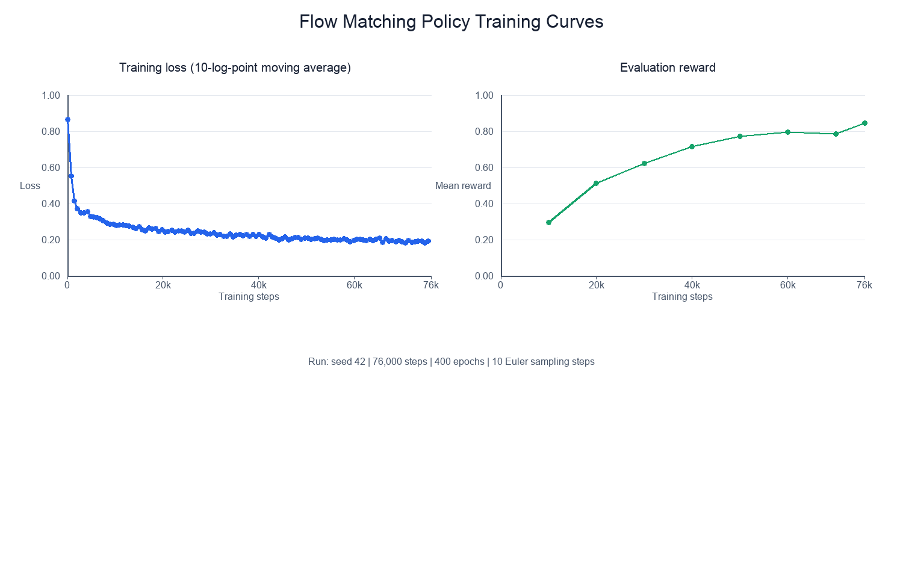

# Flow Matching Policy Report

## Training curves

The policy was trained for 400 epochs (76,000 optimizer steps), with batch size 128, learning rate 3e-4, and hidden dimensions (256, 256, 256). The plotted loss is a 10-log-point moving average of the minibatch training loss. Evaluation ran every 10,000 steps and used 100 episodes. The final training loss was 0.175; the final mean evaluation reward was **0.844** at step 76,000. The highest recorded evaluation reward was **0.844** at step 76,000.

## Qualitative comparison with MSE

In the inspected final evaluation videos, both policies move the agent to contact and push the T. The flow policy's sampled rollout ends with the T more closely aligned with the green target region, while the inspected MSE rollout ends with a visibly larger offset. This matches the final mean rewards in these runs (flow: 0.844; MSE: 0.635). This is a qualitative observation from the inspected videos, not a claim that every episode behaves this way.
