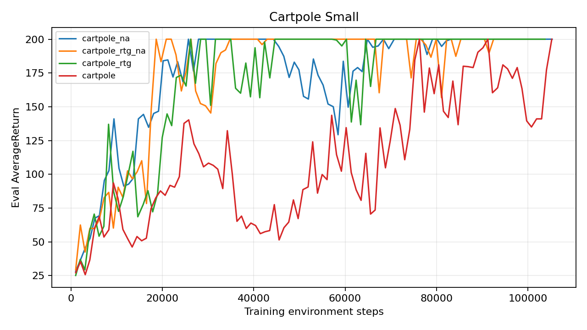
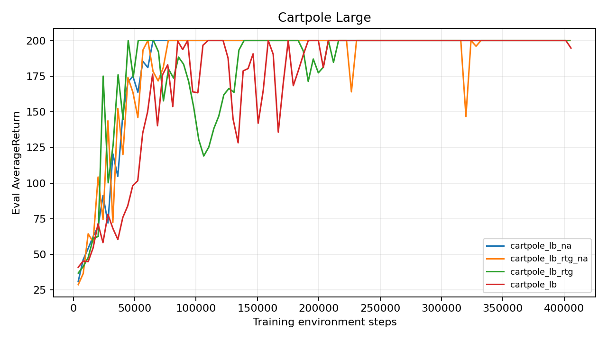
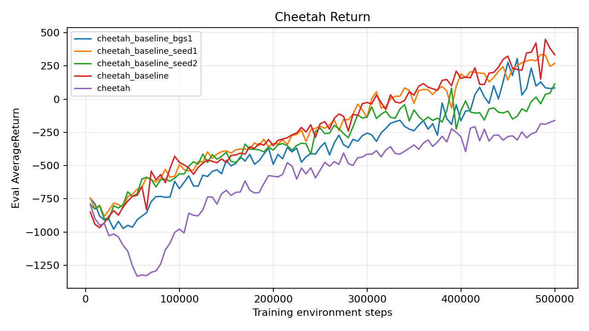
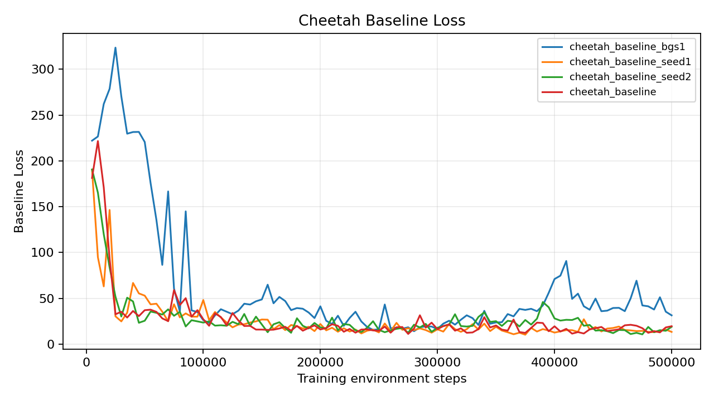
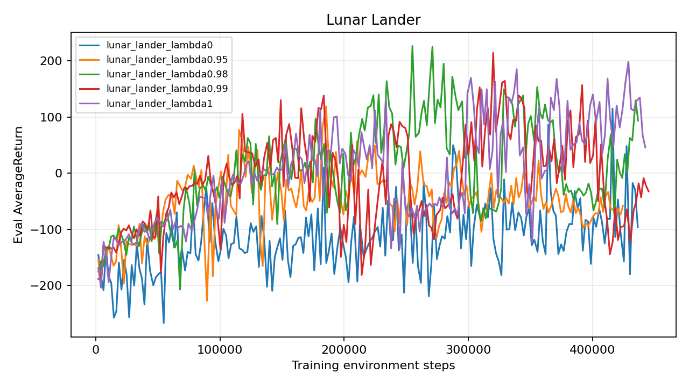
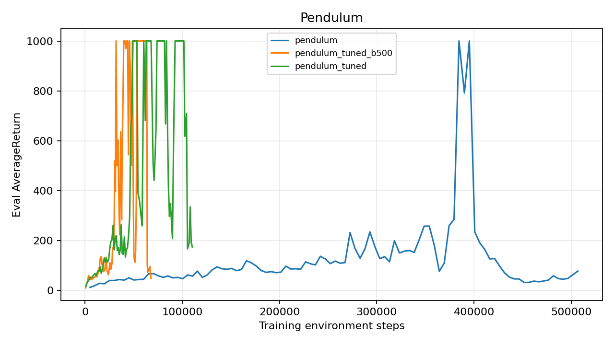

# HW2: Policy Gradients

1. CartPole

| Experiment | Final eval | Best eval | Train steps |
|---|---:|---:|---:|
| cartpole_lb_na (seed 1) | 200.0 | 200.0 | 401003 |
| cartpole_lb_rtg_na (seed 1) | 200.0 | 200.0 | 404738 |
| cartpole_lb_rtg (seed 1) | 200.0 | 200.0 | 404642 |
| cartpole_lb (seed 1) | 194.7 | 200.0 | 405514 |
| cartpole_na (seed 1) | 200.0 | 200.0 | 105315 |
| cartpole_rtg_na (seed 1) | 200.0 | 200.0 | 103677 |
| cartpole_rtg (seed 1) | 200.0 | 200.0 | 103746 |
| cartpole (seed 1) | 200.0 | 200.0 | 105234 |

Averaging the 100 logged evaluation means gives 110.2 (trajectory) versus 169.5 (reward-to-go) for the small batch, and 174.4 versus 181.9 for the large batch. This describes overall learning progress for this seed, rather than only the final evaluation.

Reward-to-go is generally preferred because an action cannot affect earlier rewards. Removing those irrelevant rewards reduces gradient variance without changing the expected policy gradient. Advantage normalization centers the weights and stabilizes their scale, although it introduces a small batch-dependent bias.

The best observed small-batch return is 200.0; the best large-batch return is 200.0. Larger batches typically make estimates less noisy, but consume more environment steps per update. The plots should therefore be compared on steps rather than iterations.

CartPole: learning curves

1. HalfCheetah baseline

| Experiment | Final eval | Best eval | Train steps |
|---|---:|---:|---:|
| cheetah_baseline_bgs1 (seed 1) | 84.5 | 305.6 | 500000 |
| cheetah_baseline_seed1 (seed 1) | 269.4 | 335.9 | 500000 |
| cheetah_baseline_seed2 (seed 2) | 114.7 | 114.7 | 500000 |
| cheetah_baseline (seed 3) | 334.5 | 450.4 | 500000 |
| cheetah (seed 1) | -160.6 | -160.6 | 500000 |

The required baseline run ends at 334.5, compared with -160.6 without a baseline. The additional ablation reduces baseline gradient steps from 5 to 1 while retaining baseline learning rate 0.01; it ends at 84.5. The baseline-loss plot records the fitting error on each current on-policy batch after its last critic step, so its targets change as the policy changes and the curve need not decrease monotonically.

HalfCheetah: baseline fitting loss

Fewer critic steps give the baseline less opportunity to track the current returns. Compare both the loss and return curves: lower fitting error is useful for variance reduction, but does not alone guarantee a higher policy return. Advantages for the actor use the critic before its updates on the current batch.

For the matched seed-1 comparison, mean baseline loss over the last 10 iterations is 14.73 with 5 critic steps and 43.34 with 1 step. Final policy returns for these matched runs are 269.4 and 84.5, respectively. All additional baseline seeds are retained rather than replacing the first result.

3. LunarLander and GAE

| Experiment | Final eval | Best eval | Train steps |
|---|---:|---:|---:|
| lunar_lander_lambda0 (seed 1) | -96.2 | 115.0 | 436499 |
| lunar_lander_lambda0.95 (seed 1) | -58.1 | 119.0 | 424568 |
| lunar_lander_lambda0.98 (seed 1) | 93.8 | 226.5 | 436738 |
| lunar_lander_lambda0.99 (seed 1) | -32.3 | 214.4 | 445191 |
| lunar_lander_lambda1 (seed 1) | 46.0 | 198.7 | 442541 |

The best observed run is lunar_lander_lambda0.98 with peak evaluation return 226.5. The curves compare lambda in {0, 0.95, 0.98, 0.99, 1} using the prescribed hyperparameters.

Peak return by lambda is 0: 115.0, 0.95: 119.0, 0.98: 226.5, 0.99: 214.4, 1: 198.7. The lambda=0 run relies most heavily on the imperfect baseline; higher lambda includes more sampled future reward. In this run, the best-performing lambda balances those sources as shown by the curve and peak values.

Lambda = 0 uses the one-step TD residual r + gamma V(next state) - V(state), which depends strongly on critic accuracy. Lambda = 1 telescopes to the full Monte Carlo reward-to-go minus V(state) at episode boundaries. Intermediate values trade some bias for lower variance; the measured returns show how that tradeoff interacts with this task and seed.

4. InvertedPendulum sample efficiency

| Experiment | Final eval | Best eval | Train steps |
|---|---:|---:|---:|
| pendulum (seed 1) | 78.2 | 1000.0 | 506839 |
| pendulum_tuned_b500 (seed 1) | 49.5 | 1000.0 | 67777 |
| pendulum_tuned (seed 1) | 174.7 | 1000.0 | 110284 |

The fastest successful configuration is pendulum_tuned_b500: evaluation mean first reaches 1000 after 31880 training steps. The default first reaches 1000 after 384573 steps.

The initial tuned configuration reduces batch size from 5000 to 1000, uses reward-to-go and normalized advantages, changes gamma from 1.0 to 0.99, and increases actor learning rate from 0.005 to 0.01. Smaller batches permit more updates within the sample budget; normalized advantages stabilize update scale. These settings are changed jointly, so this experiment cannot isolate their individual causal effects. Any further tuning attempts are included in the table and exact-command appendix.

5. Saved-policy inference

Fresh inference uses checkpoint weights loaded from agent.pt and seed 101, with no training updates. It evaluates the final saved policy, which may differ from the best intermediate policy shown in a training curve. The provided training code saves its checkpoint at the end of the run.

cartpole_lb_na: 10 episodes, mean 200.00, standard deviation 0.00.

cartpole_lb_rtg_na: 10 episodes, mean 200.00, standard deviation 0.00.

cartpole_lb_rtg: 10 episodes, mean 200.00, standard deviation 0.00.

cartpole_lb: 10 episodes, mean 196.90, standard deviation 6.67.

cartpole_na: 10 episodes, mean 200.00, standard deviation 0.00.

cartpole_rtg_na: 10 episodes, mean 200.00, standard deviation 0.00.

cartpole_rtg: 10 episodes, mean 200.00, standard deviation 0.00.

cartpole: 10 episodes, mean 198.40, standard deviation 4.80.

cheetah_baseline_bgs1: 10 episodes, mean 67.96, standard deviation 106.49.

cheetah_baseline_seed1: 10 episodes, mean 273.12, standard deviation 82.51.

cheetah_baseline_seed2: 10 episodes, mean -0.05, standard deviation 143.46.

cheetah_baseline: 10 episodes, mean 368.72, standard deviation 46.15.

cheetah: 10 episodes, mean -162.29, standard deviation 58.72.

pendulum: 10 episodes, mean 95.80, standard deviation 38.77.

pendulum_tuned_b500: 10 episodes, mean 43.00, standard deviation 16.61.

pendulum_tuned: 10 episodes, mean 226.30, standard deviation 159.54.

lunar_lander_lambda0.95: 10 episodes, mean -32.81, standard deviation 19.50.

lunar_lander_lambda0.98: 10 episodes, mean 114.10, standard deviation 37.65.

lunar_lander_lambda0.99: 10 episodes, mean -18.72, standard deviation 34.18.

lunar_lander_lambda0: 10 episodes, mean -125.71, standard deviation 144.23.

lunar_lander_lambda1: 10 episodes, mean 122.61, standard deviation 95.49.

Appendix: exact experiment commands

Every command below includes its seed explicitly. Other flags use the starter defaults unless specified. The local execution environment sets WANDB_MODE=disabled, OMP_NUM_THREADS=1, MKL_NUM_THREADS=1 and OPENBLAS_NUM_THREADS=1. The driver invokes the same commands with the virtual environment Python interpreter.

uv run src/scripts/run.py --env_name CartPole-v0 -n 100 -b 4000 -na --exp_name cartpole_lb_na --seed 1

uv run src/scripts/run.py --env_name CartPole-v0 -n 100 -b 4000 -rtg -na --exp_name cartpole_lb_rtg_na --seed 1

uv run src/scripts/run.py --env_name CartPole-v0 -n 100 -b 4000 -rtg --exp_name cartpole_lb_rtg --seed 1

uv run src/scripts/run.py --env_name CartPole-v0 -n 100 -b 4000 --exp_name cartpole_lb --seed 1

uv run src/scripts/run.py --env_name CartPole-v0 -n 100 -b 1000 -na --exp_name cartpole_na --seed 1

uv run src/scripts/run.py --env_name CartPole-v0 -n 100 -b 1000 -rtg -na --exp_name cartpole_rtg_na --seed 1

uv run src/scripts/run.py --env_name CartPole-v0 -n 100 -b 1000 -rtg --exp_name cartpole_rtg --seed 1

uv run src/scripts/run.py --env_name CartPole-v0 -n 100 -b 1000 --exp_name cartpole --seed 1

uv run src/scripts/run.py --env_name HalfCheetah-v4 -n 100 -b 5000 -eb 3000 -rtg --discount 0.95 -lr 0.01 --use_baseline -blr 0.01 -bgs 1 --exp_name cheetah_baseline_bgs1 --seed 1

uv run src/scripts/run.py --env_name HalfCheetah-v4 --exp_name cheetah_baseline --n_iter 100 --use_reward_to_go --use_baseline --baseline_learning_rate 0.01 --baseline_gradient_steps 5 --batch_size 5000 --eval_batch_size 3000 --discount 0.95 --learning_rate 0.01 --n_layers 2 --layer_size 64 --seed 1 --which_gpu 0 --video_log_freq -1 --scalar_log_freq 1

uv run src/scripts/run.py --env_name HalfCheetah-v4 --exp_name cheetah_baseline --n_iter 100 --use_reward_to_go --use_baseline --baseline_learning_rate 0.01 --baseline_gradient_steps 5 --batch_size 5000 --eval_batch_size 3000 --discount 0.95 --learning_rate 0.01 --n_layers 2 --layer_size 64 --seed 2 --which_gpu 0 --video_log_freq -1 --scalar_log_freq 1

uv run src/scripts/run.py --env_name HalfCheetah-v4 -n 100 -b 5000 -eb 3000 -rtg --discount 0.95 -lr 0.01 --use_baseline -blr 0.01 -bgs 5 --exp_name cheetah_baseline --seed 3

uv run src/scripts/run.py --env_name HalfCheetah-v4 -n 100 -b 5000 -eb 3000 -rtg --discount 0.95 -lr 0.01 --exp_name cheetah --seed 1

uv run src/scripts/run.py --env_name InvertedPendulum-v4 -n 100 -b 5000 -eb 1000 --exp_name pendulum --seed 1

uv run src/scripts/run.py --env_name InvertedPendulum-v4 --exp_name pendulum_tuned_b500 --n_iter 100 --use_reward_to_go --baseline_learning_rate 0.005 --baseline_gradient_steps 5 --normalize_advantages --batch_size 500 --eval_batch_size 1000 --discount 0.99 --learning_rate 0.01 --n_layers 2 --layer_size 64 --seed 1 --which_gpu 0 --video_log_freq -1 --scalar_log_freq 1

uv run src/scripts/run.py --env_name InvertedPendulum-v4 -n 100 -b 1000 -eb 1000 -rtg -na --discount 0.99 -lr 0.01 --exp_name pendulum_tuned --seed 1

uv run src/scripts/run.py --env_name LunarLander-v2 --ep_len 1000 --discount 0.99 -n 200 -b 2000 -eb 2000 -l 3 -s 128 -lr 0.001 --use_reward_to_go --use_baseline --gae_lambda 0.95 --exp_name lunar_lander_lambda0.95 --seed 1

uv run src/scripts/run.py --env_name LunarLander-v2 --ep_len 1000 --discount 0.99 -n 200 -b 2000 -eb 2000 -l 3 -s 128 -lr 0.001 --use_reward_to_go --use_baseline --gae_lambda 0.98 --exp_name lunar_lander_lambda0.98 --seed 1

uv run src/scripts/run.py --env_name LunarLander-v2 --ep_len 1000 --discount 0.99 -n 200 -b 2000 -eb 2000 -l 3 -s 128 -lr 0.001 --use_reward_to_go --use_baseline --gae_lambda 0.99 --exp_name lunar_lander_lambda0.99 --seed 1

uv run src/scripts/run.py --env_name LunarLander-v2 --ep_len 1000 --discount 0.99 -n 200 -b 2000 -eb 2000 -l 3 -s 128 -lr 0.001 --use_reward_to_go --use_baseline --gae_lambda 0 --exp_name lunar_lander_lambda0 --seed 1

uv run src/scripts/run.py --env_name LunarLander-v2 --ep_len 1000 --discount 0.99 -n 200 -b 2000 -eb 2000 -l 3 -s 128 -lr 0.001 --use_reward_to_go --use_baseline --gae_lambda 1 --exp_name lunar_lander_lambda1 --seed 1
